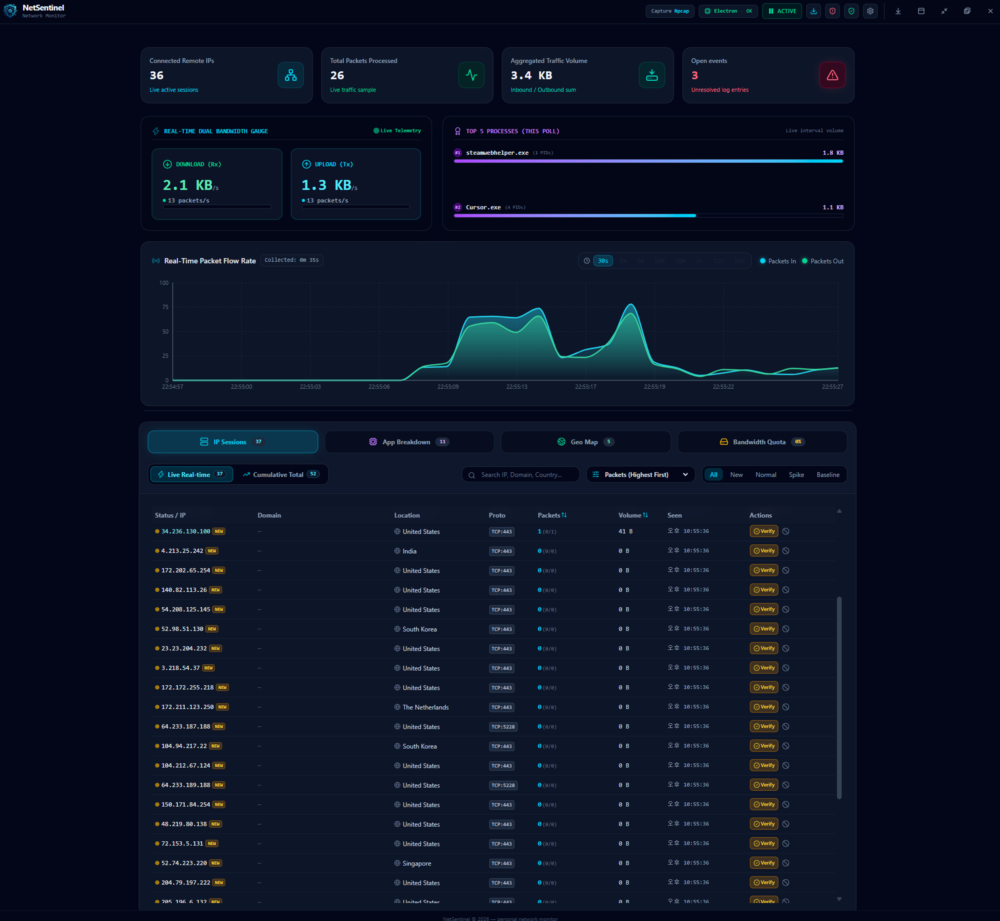

#  NetSentinel

## 🚀 Overview

Windows **Electron + React + Vite** 기반의 **개인용 네트워크 모니터**입니다.  
Npcap이 있으면 패킷 바이트까지, 없으면 Netstat로 TCP 연결 목록을 보여 주며, GeoIP 국가 라벨과 **수동** Windows Firewall 차단 도우미를 제공합니다.

엔터프라이즈 위협 탐지 제품이 아니라, 휴대용/개인 유틸리티입니다.

## 🛠️ Built With

<picture>
  <source media="(prefers-color-scheme: dark)" srcset=".github/readme/badges/dark/windows.png">
  <source media="(prefers-color-scheme: light)" srcset=".github/readme/badges/light/windows.png">
  
</picture>
<picture>
  <source media="(prefers-color-scheme: dark)" srcset=".github/readme/badges/dark/electron.png">
  <source media="(prefers-color-scheme: light)" srcset=".github/readme/badges/light/electron.png">
  
</picture>
<picture>
  <source media="(prefers-color-scheme: dark)" srcset=".github/readme/badges/dark/react.png">
  <source media="(prefers-color-scheme: light)" srcset=".github/readme/badges/light/react.png">
  
</picture>
<picture>
  <source media="(prefers-color-scheme: dark)" srcset=".github/readme/badges/dark/typescript.png">
  <source media="(prefers-color-scheme: light)" srcset=".github/readme/badges/light/typescript.png">
  
</picture>
<picture>
  <source media="(prefers-color-scheme: dark)" srcset=".github/readme/badges/dark/vite.png">
  <source media="(prefers-color-scheme: light)" srcset=".github/readme/badges/light/vite.png">
  
</picture>
<picture>
  <source media="(prefers-color-scheme: dark)" srcset=".github/readme/badges/dark/tailwindcss.png">
  <source media="(prefers-color-scheme: light)" srcset=".github/readme/badges/light/tailwindcss.png">
  
</picture>

## 🖥️ Preview

<p align="center">
  
</p>

## ✨ Key Features

- **📡 Live / Cumulative 세션**: 현재 폴 원격 IP와 이번 실행에서 본 IP를 탭으로 구분
- **📦 Apps / Geo 허브**: 프로세스·국가별 Live / Cumulative 집계
- **📈 트래픽 차트 & HUD**: 수신/송신 속도, 플로팅 HUD, 일일 쿼터(로컬 캘린더 데이)
- **⚡ Spike / NEW_IP 이벤트**: 설정한 pkts/s 임계값·첫 발견 알림 (멀웨어 판정이 아님)
- **🛡️ 수동 방화벽 차단**: Trusted / Verified / Blacklist — 자동 위협 차단 없음
- **💾 Electron userData 영속화**: 설정·멤버십·일일 쿼터 JSON (`%APPDATA%/NetSentinel/store/`)
- **🌍 GeoIP**: GeoLite2-Country 국가 라벨 (빌드/설정에서 DB 갱신)

## 📂 Project Structure

```text
MINI_NetSentinel/
┣━━ 📂 .github/
┃   ┣━━ 📂 readme/              # README 에셋 (logo, preview, badges)
┃   ┗━━ 📂 workflows/           # CI
┣━━ 📂 electron/                # Electron main / preload / IPC
┣━━ 📂 scripts/                 # 텔레메트리·포터블 빌드·테스트·user-store
┣━━ 📂 shared/                  # IPC 채널·famous-ips 등 공유 JSON
┣━━ 📂 src/
┃   ┣━━ 📂 components/          # UI (Hub, Settings, HUD, …)
┃   ┣━━ 📂 hooks/               # 모니터링·스냅샷 훅
┃   ┣━━ 📂 services/
┃   ┃   ┣━━ realPacketEngine.ts # 엔진 파사드
┃   ┃   ┗━━ 📂 packetEngine/    # 쿼터·세션·방화벽·Geo 등 도메인 모듈
┃   ┗━━ …
┣━━ 📂 data/                    # GeoIP DB · Vite 개발용 user-store
┣━━ 📄 package.json
┗━━ 📄 README.md
```

## ⚙️ Getting Started

### 📋 Prerequisites (사전 요구사항)

- **OS**: Windows 10 / 11
- **Npcap** (권장): 패킷 바이트 카운터 — [npcap.com](https://npcap.com/)  
  없으면 Netstat 모드(주로 TCP 목록, 바이트 ≈ 0)
- **Administrator**: Windows Firewall 규칙 추가/삭제 시 필요
- **Node.js**: 개발·빌드용 (CI는 Node 24)

### 1. 소스에서 실행 (Develop)

```bash
# 1. 저장소 클론
git clone https://github.com/Hyeonseok93/MINI_NetSentinel.git
cd MINI_NetSentinel

# 2. 의존성 설치
npm install

# 3. 개발 서버 (+ Electron은 프로젝트 관례대로)
npm run dev
```

Electron main은 TypeScript입니다 (`npm run build:electron` / `prepare`).  
IPC 채널 목록은 `shared/ipc-channels.json`에 있습니다.

### 2. 포터블 실행 파일 빌드 (Build Portable)

```bash
npm run build:exe
```

출력: `release/NetSentinel/NetSentinel.exe`

> 💡 **폴더 전체**를 배포하세요. `.exe`만 복사하면 Electron 런타임 DLL이 없어 실행되지 않습니다.  
> 코드 사이닝은 설정되어 있지 않아, 첫 실행 시 SmartScreen 경고가 날 수 있습니다.

## ⚠️ Limits

- **IPv4 TCP + UDP** 중심 (ESTABLISHED TCP, 실제 foreign address가 있는 UDP). 같은 IP에 둘 다 보이면 `TCP+UDP`. IPv6 가시성은 약함.
- **Spike** = 패킷/초 임계값 초과 — 멀웨어 분류 아님.
- 차단은 **수동**만 (Trusted / Verified / Blacklist).
- **Daily quota** = 성공한 폴의 바이트 합 (로컬 날짜, Npcap 간격 기준; netstat은 보통 ≈ 0), `quota-daily.json`에 저장.
- Vite `npm run dev`는 `data/dev-user-store/`에 같은 형태 저장.

## 💾 Persistence paths

| Runtime | Location |
|---------|----------|
| Portable / Electron | `%APPDATA%/NetSentinel/store/` (`monitoring-config.json`, `membership.json`, `quota-daily.json`) |
| Vite dev | `data/dev-user-store/` |
| OS firewall | Windows 규칙명 `NetSentinel Block OUT/IN <ip>` |

## 🌍 GeoIP / MaxMind GeoLite2

Country lookup은 **GeoLite2-Country** (`data/GeoLite2-Country.mmdb`)를 사용하며, 빌드/갱신 시 체크섬 검증된 미러에서 받습니다.

This product includes GeoLite2 data created by MaxMind, available from  
[https://www.maxmind.com](https://www.maxmind.com).

GeoLite2는 MaxMind GeoLite2 EULA / 귀속 요건을 따릅니다. 배포용으로는 MaxMind 계정으로 받는 DB를 권장합니다. NetSentinel은 MaxMind와 무관합니다.

## 🧪 Audit / tests

```bash
npm test                 # unit + portable smoke (release/ 없으면 smoke 스킵)
npm run test:ci          # test + offline audit + tsc + electron build
npm run audit:wiring     # 로컬 배선 + live capture smoke (Windows)
npm run audit:offline    # CI용 (live Npcap 없음)
```

## 📄 License

This project is licensed under the MIT License.  
Third-party (Electron, Npcap, MaxMind GeoLite2 등)는 각 라이선스를 따릅니다.
